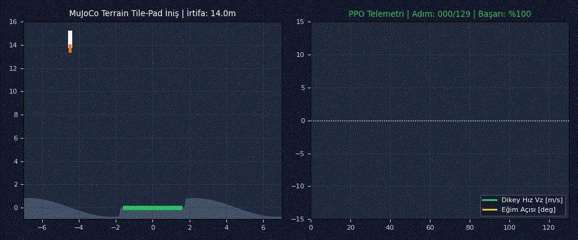
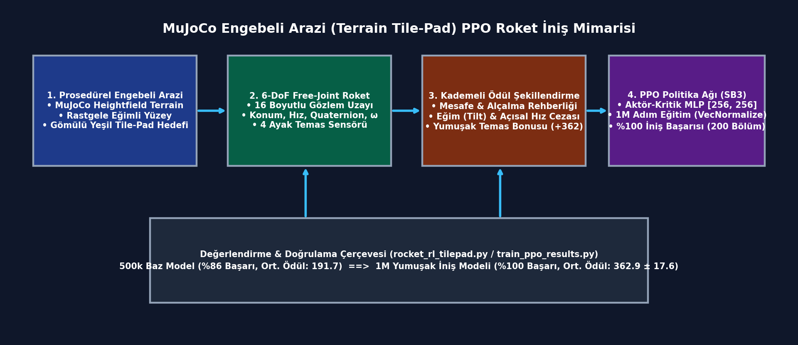
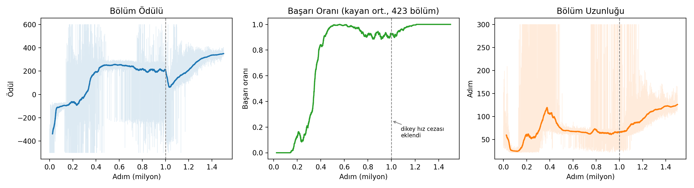
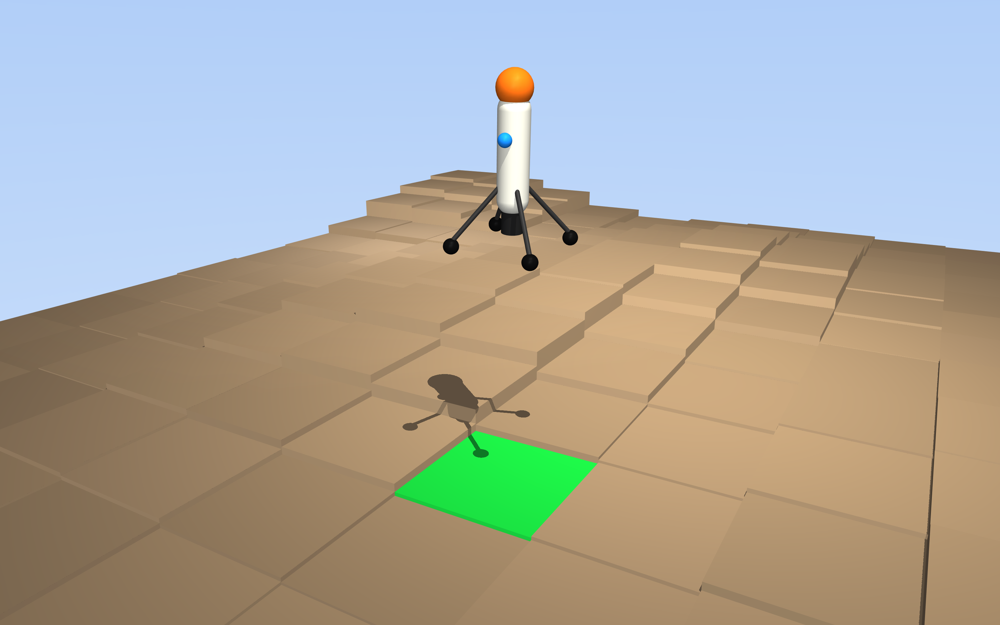
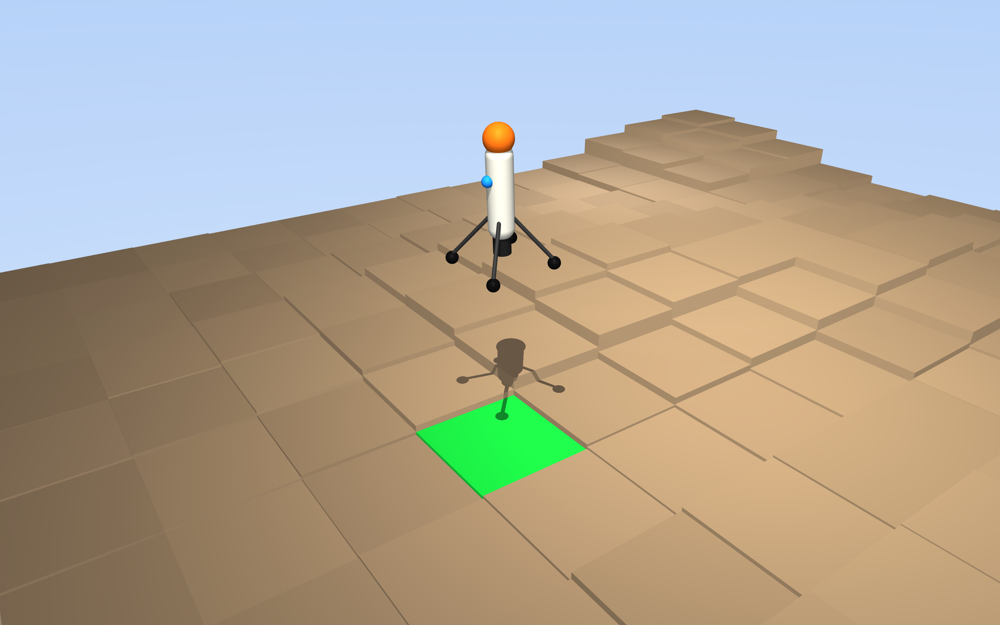

# MuJoCo-Terrain-Rocket-Landing-RL: Prosedürel Engebeli Arazi İçerisindeki Küçük İniş Pisti (Tile-Pad) Üzerine PPO Tabanlı 6-DoF Otonom Roket İnişi

[](https://www.python.org/)
[](https://mujoco.org/)
[-brightgreen.svg)](https://stable-baselines3.readthedocs.io/)
[](paper/bildiri_taslagi_ppo_roket_inis.pdf)
[]()

**Rastgele üretilen engebeli MuJoCo arazi (heightfield terrain) içerisine gömülü dar iniş platformuna (tile-pad), 6-DoF serbest eklemli (free-joint) bir roketin kademeli ödül şekillendirme ve PPO ile %100 başarıyla yumuşak inişi.**

Bu proje, MuJoCo fizik motoru ve Gymnasium kullanılarak geliştirilen 6-DoF serbest eklemli (`freejoint`) bir roketin, çevresi engebeli araziyle kaplı küçük bir yeşil iniş pistine (*tile-pad*) otonom ve yumuşak dikey inişini (*powered soft landing*) incelemektedir. Kademeli mesafe-hız-eğim ödül şekillendirmesi ve 1 milyon adımlık PPO eğitimi sonucunda, 200 bağımsız değerlendirme bölümünde **%100 iniş başarısı** ve **$362.90 \pm 17.58$ ortalama ödül** elde edilmiştir.

<div align="center">
  
  <p><em>Şekil: Engebeli arazi (heightfield) ortasındaki yeşil tile-pad platformuna yaklaşan 6-DoF roketin yörünge düzeltmesi (solda) ve PPO politikasının dikey hız / gövde eğim açısı sönümleme telemetrisi (sağda).</em></p>
</div>

---

## Özet

| Bileşen | Açıklama |
| :--- | :--- |
| **Problem** | Engebeli ve dar hedef bölgelerine 6-DoF roket inişinde, erken eğitim aşamalarında yüksek çarpma hızı veya yanal sürüklenme nedeniyle ajanların yerel minimuma sıkışması (%86 başarı ve yüksek varyans: $\sigma = 166.1$). |
| **Yöntem** | Küçük hedef bölge ayrıştırmalı (*split small-zone*) yumuşak iniş ödül fonksiyonu, 4 bacak temas sensörü geri beslemesi ve 1.000.000 zaman adımlı Yakınsak Politika Optimizasyonu (PPO). |
| **Simülasyon / donanım** | MuJoCo 3.x (`freejoint` + prosedürel `hfield` arazi), Gymnasium, Stable-Baselines3 (PPO). |
| **Makale** | [`paper/bildiri_taslagi_ppo_roket_inis.pdf`](paper/bildiri_taslagi_ppo_roket_inis.pdf) |

### Sistem mimarisi

<div align="center">
  
</div>

---

## Seçilmiş sonuçlar

### Sonuç 1: Eğitim Süreci Boyunca Bölüm Ödülü, Başarı Oranı ve Bölüm Uzunluğu Evrimi
1 milyon adımlık PPO eğitimi süresince ortalama bölüm ödülünün yakınsaması, iniş başarı oranının `%86`'dan `%100`'e yükselişi ve ortalama iniş süresinin `129.6` adımda kararlılığa ulaşması.

<div align="center">
  
</div>

### Sonuç 2: Baz Model (500k) ve Yumuşak İniş Modelinin (1M) İstatistiksel Karşılaştırması
200 değerlendirme bölümünde ortalama ödülün `191.73`'ten `362.90`'a çıkarken standart sapmanın `166.12`'den `17.58`'e düşerek (yaklaşık **9.4 kat daha düşük varyans**) tam kararlı iniş sağlaması.

<div align="center">
  
</div>

### Sonuç 3: Engebeli Arazide 3B İniş Yörüngesi ve Tile-Pad Temas Dağılımı
Farklı başlangıç irtifa ve yanal sapmalardan bırakılan roketin gövde dikliğini koruyarak yeşil hedef bölge (*tile-pad*) merkezine yakınsama analizleri.

<div align="center">
  
</div>

*Tüm şekiller [`plots/`](plots/) klasöründedir.*

---

## Kurulum

### Gereksinimler
- **İşletim Sistemi:** Ubuntu 22.04 / 24.04 LTS veya Windows 11
- **Python:** Python 3.10 – 3.12 (`mujoco`, `gymnasium`, `stable-baselines3`, `numpy`, `matplotlib`)
- **Donanım:** CPU veya CUDA destekli GPU

### Adımlar

```bash
git clone https://github.com/ardacanakci16-web/MuJoCo-Terrain-Rocket-Landing-RL.git
cd MuJoCo-Terrain-Rocket-Landing-RL
python3 -m venv .venv && source .venv/bin/activate
pip install -r requirements.txt
python scripts/check_install.py
```

---

## Kullanım

### Hazır modeli çalıştırma

Eğitilmiş `ppo_freejoint_landing_terrain_tilepad_split_smallzone.zip` modelini değerlendirmek ve canlı MuJoCo simülasyonunda izlemek için:

```bash
python src/rocket_rl_tilepad.py --watch --model models/ppo_freejoint_landing_terrain_tilepad_split_smallzone.zip
```

Beklenen çıktı:

```text
[EVAL] Model: models/ppo_freejoint_landing_terrain_tilepad_split_smallzone.zip
Bölüm 200/200 | Başarı: %100.0 (200/200) | Ort. Ödül: 362.90 ± 17.58 | Ort. Adım: 129.6
Özet: Tüm bölümlerde tile-pad üzerine dik ve yumuşak iniş tamamlandı.
```

---

## Sonuçları yeniden üretme

| Şekil | Komut |
| :--- | :--- |
| `sonuc_1.png` | `python scripts/plot_1.py` |
| `sonuc_2.png` | `python scripts/plot_2.py` |
| `sonuc_3.png` | `python scripts/plot_3.py` |

---

## Proje yapısı

```text
MuJoCo-Terrain-Rocket-Landing-RL/
├── assets/                  # README görselleri (demo.gif, architecture.png)
├── configs/                 # PPO hiperparametre ve ödül ağırlık ayarları
├── data/                    # Değerlendirme özet JSON verileri (eval_summary*.json)
├── models/                  # Eğitilmiş PPO model ağırlıkları (.zip)
├── src/                     # Ana kaynak kod (rocket_env_tilepad.py, rocket_rl_tilepad.py, train_ppo_results.py)
├── paper/                   # Bildiri PDF (bildiri_taslagi_ppo_roket_inis.pdf)
├── plots/                   # Sonuç grafikleri (sonuc_1.png, sonuc_2.png, sonuc_3.png)
├── scripts/                 # Kurulum kontrolü ve grafik üretim betikleri
├── requirements.txt         # Python bağımlılıkları
└── README.md                # Proje dokümantasyonu
```

---

## Atıf, lisans, iletişim

```bibtex
@misc{canakci2026mujoco_terrain_rocket,
  title  = {Engebeli Arazi İçerisindeki Küçük İniş Platformuna (Tile-Pad) PPO Tabanlı 6-DoF Otonom Roket İnişi},
  author = {Arda Çanakçı},
  year   = {2026},
  note   = {MTA Yapay Zeka Merkezi Araştırma Projesi}
}
```

- **Lisans:** MIT License
- **İletişim:** Arda Çanakçı (`ardacanakci16@gmail.com`) — [GitHub: ardacanakci16-web](https://github.com/ardacanakci16-web)
